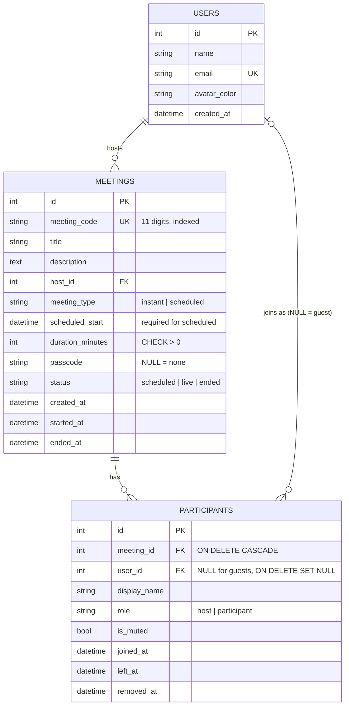

# Zoom Clone

A web clone of the Zoom web app: a dashboard, instant and scheduled meetings, joining by meeting ID or
invite link, a pre-join screen with camera preview, and a meeting room with a participants panel and host
controls. Built as a full-stack assignment: **Next.js** frontend, **FastAPI** backend, **SQLite** database.

> There is no real audio/video between people (see [Assumptions](#assumptions-and-limitations)). Everything
> else (meeting data, participants, mute and remove) is real and stored in the database.

## Tech stack

| Part | Technology |
|---|---|
| Frontend | Next.js 16 (App Router, Cache Components), React 19, TypeScript, Tailwind CSS 4, lucide-react icons, date-fns |
| Backend | Python 3.12, FastAPI, SQLAlchemy 2, Pydantic 2, Uvicorn |
| Database | SQLite (tables are created and filled with sample data on startup) |
| Tests | pytest (backend, 83 tests) |

## Features

- **Dashboard** (`/`): Zoom-style header and sidebar, **New Meeting / Join / Schedule** tiles, **Upcoming** meetings and **Recent** meetings loaded from the backend, profile and avatar placeholders.
- **Instant meeting**: New Meeting creates a meeting with a unique 11-digit ID (shown as `123 4567 8901`) and a shareable invite link, then opens the pre-join screen as host.
- **Join** (`/join`): by meeting ID (spaces or dashes allowed) **or a pasted invite link**; the meeting is validated first, then you enter a display name on the pre-join screen. Wrong passcode, unknown ID and ended meetings show clear messages.
- **Schedule** (`/meeting/schedule`): topic, description, date and time pickers, duration, passcode option; saved to the database and shown in Upcoming. After saving, the meeting details page (`/meeting/{id}`) shows the passcode (hidden until *Show*), invite link, *Copy Invitation* and *Delete*.
- **Meetings list** (`/meeting`): Upcoming and Previous tabs grouped by day.
- **Pre-join** (`/join/{id}`): live camera preview (`getUserMedia`), mic and camera toggles, name field, passcode field when needed.
- **Meeting room** (`/room/{id}`): dark Zoom-style room, bottom control bar (Mute, Video, Participants, Share link, Host tools, End/Leave), participants panel refreshed every 3 seconds.
- **Host controls**: mute all, remove a participant, end the meeting for everyone. A removed person sees "You were removed", everyone sees "This meeting has ended".
- **Responsive layout** (phone, tablet, laptop): below 1024px the sidebar becomes a slide-in drawer opened from a hamburger button and the dashboard stacks into one column with the quick actions first; forms and the details page stack their labels above the fields; the Meetings tabs scroll sideways; in the room the control bar shows only the main buttons with short labels on phones and the participants panel covers the stage. Checked at 320, 375, 768, 1024 and 1536 px wide.

## Run it locally

You need Python 3.12 and Node 20 or newer.

**1. Backend** (from `backend/`)

```bash
python -m venv venv
venv\Scripts\activate            # macOS/Linux: source venv/bin/activate
pip install -r requirements.txt
uvicorn app.main:app --port 8000
```

The first start creates `zoom.db` and fills it with sample users and meetings. API docs: http://localhost:8000/docs.
Optional settings are in `backend/.env.example` (copy it to `backend/.env`).

**2. Frontend** (from `frontend/`)

```bash
npm install
copy .env.example .env.local     # macOS/Linux: cp .env.example .env.local
npm run dev                      # http://localhost:3000
```

The frontend must run on port 3000 locally because the backend only allows that address for CORS (`FRONTEND_URL`).

**3. Tests and checks**

```bash
cd backend && pip install -r requirements-dev.txt && python -m pytest tests -v
cd frontend && npm run lint && npm run build
```

## Project structure

```
backend/
  app/
    main.py                  app, CORS, create tables + seed on startup
    database_connection.py   engine, session, foreign keys on for SQLite
    database_models.py       the tables (this file IS the schema)
    api_schemas.py           Pydantic request/response shapes
    sample_data_seeder.py    sample data, dates relative to "now"
    routers/                 HTTP endpoints (no business rules)
    services/                business rules (meetings, participants, host controls)
  tests/                     pytest tests, in-memory SQLite
frontend/
  app/(site)/                pages with the Zoom website shell: dashboard, /meeting, /meeting/schedule, /meeting/[code]
  app/(simple)/              light shell: /join and /join/[code] (pre-join)
  app/(meeting)/             full-screen /room/[code]
  components/                reusable UI (Navbar, ActionTile, MeetingCard, Modal, ControlBarButton, ParticipantTile, ...)
  hooks/ lib/                data loading, API client (the only place that calls the backend), helpers
docs/zoom-design-analysis.md notes taken from the reference screenshots (colours, sizes, layout)
```

## Database design



Design decisions worth knowing:

- **"Upcoming" and "Recent" are queries, not stored data.** Upcoming = scheduled meetings of the host that have not finished; Recent = meetings that have started, newest first.
- **The invite link is not stored.** It is built from `meeting_code` and `passcode`, so it can never disagree with them.
- **`meeting_code` is text**, not a number: it is never used in maths, and text cannot lose a leading zero. It is unique and indexed.
- **A participant row is one visit.** Joining again creates a new row, so the table is also an attendance history. A person is "inside" while `left_at` and `removed_at` are both empty. `removed_at` is separate from `left_at` so a removed person's next poll can show why they disappeared.
- **Guests are rows with `user_id = NULL`**, so no account is needed to join.
- **Constraints do the policing**: `CHECK duration_minutes > 0`, `CHECK meeting_type = 'instant' OR scheduled_start IS NOT NULL`, enum columns limited to their allowed values, a composite index `(meeting_id, left_at)` for the room's polling query, and foreign keys that are really enforced (SQLite ignores them unless switched on per connection).
- **All times are stored in UTC** and shown in the viewer's time zone (the API sends them with a `Z` suffix).

## API

| Method and path | Purpose |
|---|---|
| `GET /api/me` | the logged-in (default) user |
| `GET /api/meetings/upcoming` · `/recent` | the host's Upcoming / Recent lists |
| `POST /api/meetings/instant` · `/schedule` | create a meeting |
| `GET /api/meetings/{code}` | public details (never the passcode) |
| `GET /api/meetings/{code}/details` · `DELETE /api/meetings/{code}` | host only: passcode and invite link / delete |
| `POST /api/meetings/{code}/join` | join as host or guest (passcode checked for guests) |
| `POST /api/meetings/{code}/leave?participant_id=` | leave (the host leaving ends the meeting) |
| `GET /api/meetings/{code}/participants?participant_id=` | who is inside, meeting status, `was_removed` |
| `PATCH /api/meetings/{code}/participants/{id}` | mute or unmute yourself |
| `POST /api/meetings/{code}/mute-all?host_participant_id=` | host only: mute everyone else |
| `DELETE /api/meetings/{code}/participants/{id}?host_participant_id=` | host only: remove someone |

## Assumptions and limitations

- **No login.** A default user (id 1, "Mitul Goyal") is always signed in. Joining through *New Meeting* or *Start* makes you the host; joining through the Join page makes you a guest.
- **No real audio or video between people** (that would need WebRTC and a signalling server). The camera preview and the camera tile in the room are real for your own device; other people appear as avatar tiles. Mute states, the participant list and host controls are real and shared through the database (polled every 3 seconds).
- **Host identity is the host's participant id.** With no login, anyone who knew that id could act as host. A real version needs authentication.
- **The host leaving ends the meeting.** Zoom lets the host leave and hand over; here *End Meeting for All* and *Leave Meeting* do the same thing.
- **A removed person can join again** with a new name (there is no identity to block).
- **Closing the tab** removes a guest from the list (the browser's `sendBeacon`). A host who closes the tab stays listed, so a page reload cannot end the meeting by accident.
- **Passcodes** are generated by the server (6 letters and digits). The Schedule form has a Passcode checkbox (on by default); with it off, anyone with the meeting ID can join.
- **Zoom marketing parts are static decoration**: the sidebar product list, Personal Meeting ID, booking links, calendar links, plan buttons, chat button and similar. The "zoom" logo is drawn as text, not copied artwork.
- **Sample data is rebuilt on every start** when the database is empty (hosting disks are temporary), with dates relative to the current time so Upcoming is never empty.

## Deployment

Backend on [Render](https://render.com) (web service), frontend on [Vercel](https://vercel.com).

1. **Backend (Render).** New *Web Service* from this repository, root directory `backend`, build command `pip install -r requirements.txt`, start command `uvicorn app.main:app --host 0.0.0.0 --port $PORT`. (`render.yaml` in the repository root describes the same settings.) Set `FRONTEND_URL` once the frontend address is known.
2. **Frontend (Vercel).** Import the repository, set the *Root Directory* to `frontend`, and add the environment variable `NEXT_PUBLIC_API_URL` = the Render service URL (no trailing slash).
3. **Close the loop.** Put the Vercel URL into `FRONTEND_URL` on Render (it is used for CORS and for invite links) and redeploy the backend.

On Render's free plan the service sleeps when idle, so the first request can take about a minute; the database is recreated and re-seeded after each restart.
