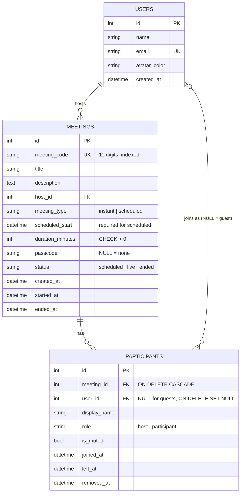

# Zoom Clone

A web clone of the Zoom web app: a dashboard, instant and scheduled meetings, joining by meeting ID or
invite link, a pre-join screen with camera preview, and a meeting room with a participants panel and host
controls. Built as a full-stack assignment: **Next.js** frontend, **FastAPI** backend, **SQLite** database
(Postgres when deployed, see [Database](#database-design)).

## Live demo

| What | Link |
|---|---|
| **Deployed app** | https://zoom-clone-web-rouge.vercel.app |
| Backend API (interactive docs) | https://zoom-clone-eight-hazel.vercel.app/docs |
| Backend health check | https://zoom-clone-eight-hazel.vercel.app/api/health |
| Source code | https://github.com/mitulgoyalofficial-pixel/zoom-clone |

> There is no real audio/video between people (see [Assumptions](#assumptions-and-limitations)). Everything
> else (meetings, participants, mute, remove, ending a meeting) is real and stored in the database.
> The first request after a quiet period can take a few seconds while the serverless backend starts.

### A two-minute tour

1. **Dashboard** shows sample *Upcoming* and *Recent* meetings (seeded data).
2. **New Meeting** creates an instant meeting and opens the pre-join screen: allow the camera, keep your name, press **Join**.
3. In the room press **Share** to copy the invite link. Open it in a **private window**: enter a name and join as a guest.
4. Back in the first window open **Participants**: the guest is listed. Try **Mute All** and **Remove**, then **End > End Meeting for All**.
5. **Schedule** a meeting: after *Save* its details page shows the meeting ID, passcode (*Show*) and invite link; it also appears in *Upcoming* on the dashboard and on the **Meetings** page.
6. **Join** (header or tile) accepts a meeting ID (`123 4567 8901`) or a pasted invite link.
7. Shrink the window or open it on a phone to see the responsive layout.

## Assignment checklist

| Requirement (from the brief) | Where it is |
|---|---|
| Next.js frontend, Python FastAPI backend | `frontend/` (App Router, client-side data fetching), `backend/` |
| SQLite database, own schema | `backend/app/database_models.py`; SQLite locally, Postgres when deployed ([why](#database-design)) |
| **1. Dashboard**: Zoom-like UI, navbar with profile/settings placeholders | `/`; avatar menu with *Profile* and *Settings* placeholders |
| New Meeting / Join Meeting / Schedule Meeting buttons | the three tiles on the dashboard (also *Join* and *Schedule* in the header) |
| Upcoming meetings section | *Meetings* card on the dashboard and the *Upcoming* tab on `/meeting` |
| Recent meetings section | *Recent meetings* card on the dashboard and the *Previous* tab on `/meeting` |
| **2. Instant meeting**: create instantly, unique meeting ID | *New Meeting*; 11-digit ID, unique in the database (shown as `123 4567 8901`) |
| Shareable invite link | *Share* in the room, *Invite Link* and *Copy Invitation* on `/meeting/{id}` |
| Redirect to the meeting room | New Meeting > pre-join screen (camera check, name) > `/room/{id}` |
| **3. Join** by meeting ID or invite link | `/join` (ID with spaces/dashes, or the full link with its passcode) |
| Display name before joining | pre-join screen `/join/{id}` (Join stays disabled until a name is entered) |
| Validate that the meeting exists | `/join` asks the backend first; unknown IDs and ended meetings get a clear message |
| **4. Schedule**: title, description, date and time picker, duration | `/meeting/schedule` |
| Auto-generated meeting link, stored in the database, shown in Upcoming | details page after saving; `meetings` table; dashboard *Upcoming* |
| Bonus: responsive design | phone, tablet, laptop ([details](#features)) |
| Bonus: host controls (mute all, remove participant) | room > Participants panel and *Host tools* |
| Bonus: authentication | not built; the brief allows a default logged-in user |
| Sample data | 5 users, 3 upcoming and 3 past meetings with participants ([seeding](#assumptions-and-limitations)) |
| README with setup, stack and assumptions | this file |

## Tech stack

| Part | Technology |
|---|---|
| Frontend | Next.js 16 (App Router, Cache Components), React 19, TypeScript, Tailwind CSS 4, lucide-react icons, date-fns |
| Backend | Python 3.12, FastAPI, SQLAlchemy 2, Pydantic 2, Uvicorn |
| Database | SQLite locally; Postgres (Neon, free) when deployed on Vercel |
| Hosting | Vercel (two projects: frontend and backend) + Neon, all on free plans |
| Tests | pytest (backend, 101 tests), ESLint + production build (frontend) |

## Features

- **Dashboard** (`/`): Zoom-style header and sidebar, **New Meeting / Join / Schedule** tiles, **Upcoming** and **Recent** meetings loaded from the backend, profile and settings placeholders in the avatar menu.
- **Instant meeting**: New Meeting creates a meeting with a unique 11-digit ID and a passcode, then opens the pre-join screen as host.
- **Join** (`/join`): by meeting ID (spaces or dashes allowed) **or a pasted invite link**; the meeting is validated first, then you enter a display name on the pre-join screen. Wrong passcode, unknown ID and ended meetings show clear messages.
- **Schedule** (`/meeting/schedule`): topic, description, date and time pickers, duration, passcode option; saved to the database and shown in Upcoming. After saving, the meeting details page (`/meeting/{id}`) shows the passcode (hidden until *Show*), the invite link, *Copy Invitation* and *Delete*.
- **Meetings list** (`/meeting`): Upcoming and Previous tabs grouped by day.
- **Pre-join** (`/join/{id}`): live camera preview (`getUserMedia`), mic and camera toggles, name field, passcode field when needed.
- **Meeting room** (`/room/{id}`): dark Zoom-style room, bottom control bar (Mute, Video, Participants, Share link, Host tools, End/Leave), participants panel refreshed every 3 seconds.
- **Host controls**: mute all, remove a participant, end the meeting for everyone. A removed person sees "You were removed", everyone sees "This meeting has ended".
- **Responsive layout** (phone, tablet, laptop): below 1024px the sidebar becomes a slide-in drawer opened from a hamburger button and the dashboard stacks into one column with the quick actions first; forms and the details page stack their labels above the fields; the Meetings tabs scroll sideways; in the room the control bar shows only the main buttons with short labels on phones and the participants panel covers the stage. Checked at 320, 375, 768, 1024 and 1536 px wide.

## Run it locally

You need Python 3.12 and Node 20 or newer.

**1. Backend** (from `backend/`)

```bash
python -m venv venv
venv\Scripts\activate            # macOS/Linux: source venv/bin/activate
pip install -r requirements.txt
uvicorn app.main:app --port 8000
```

The first start creates `zoom.db` (SQLite) and fills it with sample users and meetings. API docs: http://localhost:8000/docs.
Optional settings are in `backend/.env.example` (copy it to `backend/.env`).

**2. Frontend** (from `frontend/`)

```bash
npm install
copy .env.example .env.local     # macOS/Linux: cp .env.example .env.local
npm run dev                      # http://localhost:3000
```

The frontend must run on port 3000 locally because the backend only allows that address for CORS (`FRONTEND_URL`).

**3. Tests and checks**

```bash
cd backend && pip install -r requirements-dev.txt && python -m pytest tests -v
cd frontend && npm run lint && npm run build
```

### Environment variables

| Variable | Where | Meaning | Default |
|---|---|---|---|
| `FRONTEND_URL` | backend | address of the frontend; used for CORS and to build invite links | `http://localhost:3000` |
| `DATABASE_URL` | backend | database to use; a `postgres://` / `postgresql://` URL switches to Postgres | SQLite file `./zoom.db` |
| `NEXT_PUBLIC_API_URL` | frontend | address of the backend (read at build time) | `http://localhost:8000` |

## Project structure

```
backend/
  app/
    main.py                  app, CORS, create tables + seed on startup, health check
    database_connection.py   engine (SQLite or Postgres from DATABASE_URL), session, foreign keys
    database_models.py       the tables (this file IS the schema)
    api_schemas.py           Pydantic request/response shapes
    sample_data_seeder.py    sample data, dates relative to "now"
    routers/                 HTTP endpoints (no business rules)
    services/                business rules (meetings, participants, host controls, error types)
  tests/                     pytest tests, in-memory SQLite
frontend/
  app/(site)/                pages with the Zoom website shell: dashboard, /meeting, /meeting/schedule, /meeting/[code]
  app/(simple)/              light shell: /join and /join/[code] (pre-join)
  app/(meeting)/             full-screen /room/[code]
  components/                reusable UI (Navbar, ActionTile, MeetingCard, Modal, ControlBarButton, ParticipantTile, ...)
  hooks/ lib/                data loading, API client (the only place that calls the backend), helpers
docs/zoom-design-analysis.md notes taken from screenshots of Zoom's web app (colours, sizes, layout)
```

The backend is layered: **routers** only translate HTTP, **services** hold the rules and raise their own
error types, and one table maps those errors to HTTP status codes. On the frontend, pages only arrange
components, every backend call goes through `lib/apiClient.ts`, and shared look-and-feel lives in small
reusable components.

## Database design



Design decisions worth knowing:

- **"Upcoming" and "Recent" are queries, not stored data.** Upcoming = scheduled meetings of the host that have not finished; Recent = meetings that have started, newest first.
- **The invite link is not stored.** It is built from `meeting_code` and `passcode`, so it can never disagree with them.
- **`meeting_code` is text**, not a number: it is never used in maths, and text cannot lose a leading zero. It is unique and indexed.
- **A participant row is one visit.** Joining again creates a new row, so the table is also an attendance history. A person is "inside" while `left_at` and `removed_at` are both empty. `removed_at` is separate from `left_at` so a removed person's next poll can show why they disappeared.
- **Guests are rows with `user_id = NULL`**, so no account is needed to join.
- **Constraints do the policing**: `CHECK duration_minutes > 0`, `CHECK meeting_type = 'instant' OR scheduled_start IS NOT NULL`, enum columns limited to their allowed values, a composite index `(meeting_id, left_at)` for the room's polling query, and foreign keys that are really enforced (SQLite ignores them unless switched on per connection).
- **All times are stored in UTC** and shown in the viewer's time zone (the API sends them with a `Z` suffix).
- **SQLite locally, Postgres when deployed.** The brief asks for SQLite, and the app uses it by default. On Vercel the backend runs as a serverless function whose disk is temporary and separate for every instance, so a SQLite file there would lose data between requests. The deployed backend therefore points `DATABASE_URL` at a free Neon Postgres database. The schema and code are the same; tests check that the schema compiles for Postgres with all its constraints.

## API

| Method and path | Purpose |
|---|---|
| `GET /api/health` | server and database status |
| `GET /api/me` | the logged-in (default) user |
| `GET /api/meetings/upcoming` · `/recent` | the host's Upcoming / Recent lists |
| `POST /api/meetings/instant` · `/schedule` | create a meeting |
| `GET /api/meetings/{code}` | public details (never the passcode) |
| `GET /api/meetings/{code}/details` · `DELETE /api/meetings/{code}` | host only: passcode and invite link / delete |
| `POST /api/meetings/{code}/join` | join as host or guest (passcode checked for guests) |
| `POST /api/meetings/{code}/leave?participant_id=` | leave (the host leaving ends the meeting) |
| `GET /api/meetings/{code}/participants?participant_id=` | who is inside, meeting status, `was_removed` |
| `PATCH /api/meetings/{code}/participants/{id}` | mute or unmute yourself |
| `POST /api/meetings/{code}/mute-all?host_participant_id=` | host only: mute everyone else |
| `DELETE /api/meetings/{code}/participants/{id}?host_participant_id=` | host only: remove someone |

## Assumptions and limitations

- **No login.** A default user (id 1, "Mitul Goyal") is always signed in. Joining through *New Meeting* or *Start* makes you the host; joining through the Join page or an invite link makes you a guest.
- **No real audio or video between people** (that would need WebRTC and a signalling server). The camera preview and the camera tile in the room are real for your own device; other people appear as avatar tiles. Mute states, the participant list and host controls are real and shared through the database (polled every 3 seconds).
- **Host identity is the host's participant id.** With no login, anyone who knew that id could act as host. A real version needs authentication.
- **The host leaving ends the meeting.** Zoom lets the host leave and hand over; here *End Meeting for All* and *Leave Meeting* do the same thing.
- **A removed person can join again** with a new name (there is no identity to block).
- **Closing the tab** removes a guest from the list (the browser's `sendBeacon`). A host who closes the tab stays listed, so a page reload cannot end the meeting by accident.
- **Passcodes** are generated by the server (6 letters and digits). The Schedule form has a Passcode checkbox (on by default); with it off, anyone with the meeting ID can join.
- **Zoom marketing parts are static decoration**: the sidebar product list, Personal Meeting ID, booking links, calendar links, plan buttons, chat button and similar. The "zoom" logo is drawn as text, not copied artwork. Screens of Zoom that were not available as reference (pre-join, participants panel, phone layouts) use our own design in Zoom's style.
- **Sample data** is created once, when the database is empty, with dates relative to that moment. Because the deployed database keeps its data, the sample upcoming meetings drift into the past; whenever the backend starts and finds no upcoming meeting at all, it adds the three sample ones again with fresh dates.
- **Original work**: the code was written for this assignment; layout measurements come from screenshots of Zoom's web app, not from Zoom's code or other repositories.

## Deployment (Vercel only, free)

Live: the frontend is the Vercel project `zoom-clone-web` (https://zoom-clone-web-rouge.vercel.app) and the backend is the project `zoom-clone` (https://zoom-clone-eight-hazel.vercel.app), with a free Neon Postgres database. Pushing to `main` redeploys both. Nothing here needs a credit card.

To set it up from scratch:

1. **Backend project.** Vercel, *Add New > Project*, import this repository, set the *Root Directory* to `backend` (Vercel detects FastAPI from `app/main.py`). Add the environment variable `FRONTEND_URL` with any value for now, then *Deploy*.
2. **Database.** In the backend project open *Storage*, *Create Database*, choose **Neon** (free plan), and connect it to the project. Vercel adds `DATABASE_URL` for you. Redeploy the backend. Check `https://<backend>.vercel.app/api/health`, it must answer `{"status":"ok","database":"ok"}`.
3. **Frontend project.** Add another project from the same repository with the *Root Directory* `frontend` and the environment variable `NEXT_PUBLIC_API_URL` = the backend address from step 1 (no trailing slash). Deploy.
4. **Close the loop.** In the backend project set `FRONTEND_URL` to the exact frontend address (no trailing slash; it is used for CORS and for invite links) and redeploy the backend.

Vercel's free *Hobby* plan is for personal, non-commercial use, which fits this assignment.
